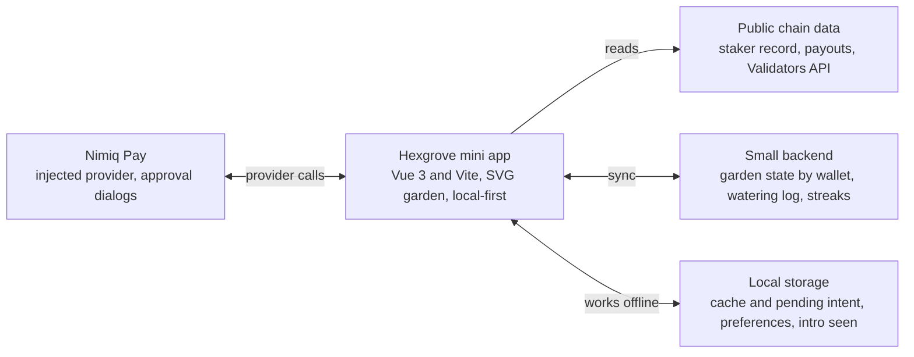
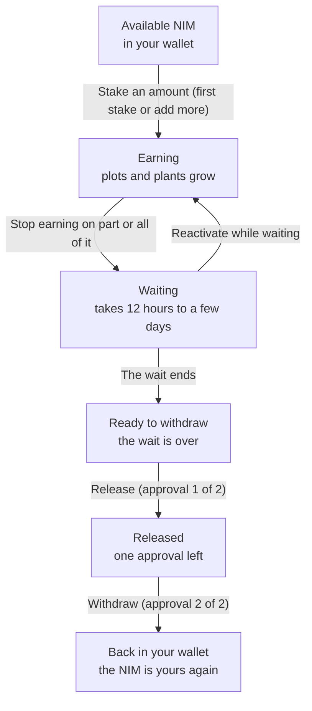

# Hexgrove build spec

Last updated: 2026-11-01

## Overview

Hexgrove is a Nimiq Pay mini app where staking NIM grows a garden of hexagonal plots, built for the Earn category of the Nimiq Mini Apps Competition, Cycle 3.

The promise on the first screen is "Stake NIM. Grow a garden." Cycle 3 runs October 14 to November 11, 2026, with $4,000 per category and $17,000 in total. Confirm the exact cutoff time on miniappscompetition.com before submitting.

The design source of truth is `hexgrove-mockup.html`: a single clickable file with every screen, state and flow, using sample data. This spec records the decisions behind it and what the real app needs.

**What makes it different.** Other Cycle 3 Earn apps already stake well. Hexgrove's identity is the garden itself, tied to real staking data, plus one idea none of the apps I found use: the chosen validator's recent reliability shows up in the garden as sky and soil.

| Scored area | Points | How Hexgrove earns it |
| --- | --- | --- |
| Functionality, reliability, usefulness | 45 | A complete staking flow with every failure handled, fast loading, clear audience, daily reason to return |
| Nimiq Pay and Nimiq integration | 25 | Native provider: accounts, signing, the six staking calls, real chain data |
| Real usage | 15 | Early testers, a shareable garden card, a live app that stays up |
| Design and UX | 10 | Minimal Nimiq-style hex garden, clear text labels, polished states |
| Builder promotion checklist | 5 | Public social post and the rest of the checklist (confirm its items) |

## Locked product decisions

These choices were made during design and stay unless testing proves them wrong.

| Area | Decision |
| --- | --- |
| Category | Earn. Save is a separate category and is not entered |
| Name | Hexgrove |
| Core idea | A garden of many hex plots that grows as a NIM stake earns rewards |
| Visual style | Minimal and clean, Nimiq-style: dark navy background, gold accent (#F6B221), hexagon motif |
| What drives the garden | Amount staked sets the number of plots; rewards earned set each plant's growth stage; the watering streak sets glow only |
| Watering | One tap per day, visual only. It never changes rewards, and the UI says so |
| Missed day | Plants dim and the streak resets. Unlocked plants stay unlocked forever |
| Plants | A seeded mix per user (seed from the wallet address) so the garden is the same on every device |
| Unlocks | Common plants unlock from rewards earned; rare plants unlock from watering streaks |
| Validator conditions | The chosen validator's recent reliability shows as the garden's sky and soil: sunny, cloudy, stormy, or dusk when data is missing |
| Validator choice | Users browse and choose. A Recommended tag is only a hint, with published criteria, and several pools can carry it |
| Onboarding | A short, skippable 3-card intro shown once, then staking |
| Unstaking | Users choose the amount to stop earning, with quick amounts of 25%, 50%, 75% and 100% |
| Share card | The user chooses what it shows. Amounts are off by default. It can show a "watered today" badge |
| Sound | Soft ambient loop plus short chimes, an always-visible mute, audio starts only after the first tap |
| Leaderboard | None for now. Keep the data model ready so it can be added on the roadmap |
| Left out on purpose | XP, tiers, skins, quests and invite codes. Other Earn apps already use them, and they would blur Hexgrove's identity |
| Stack | Vue 3 with Vite, SVG with CSS animation, local-first data with a small backend sync |

## Stack and architecture

Hexgrove is a Vue 3 and Vite single-page app that draws the garden as SVG, reads chain data directly, and uses a small backend only for watering history and preferences.



**Stack choices**

- Vue 3 with Vite and no server-side rendering. Nimiq's mini app docs include Vue examples, and [Kickback](https://github.com/shrooms08/kickback) is a Vue 3 and Vite app.
- The garden is SVG with CSS animation. Hexagons and geometric plants are natural SVG shapes, stay crisp on any phone, and are small.
- Data is local-first, synced to a small backend keyed to the wallet address.
- Sound uses the Web Audio API and starts only after the first tap.
- The repository is public under the MIT license, as the competition requires.

## Nimiq integration

Hexgrove talks to Nimiq Pay through its injected provider for anything the user must approve, and reads everything else from public chain data.

The method names below come from the Kickback and NimJar reference apps. Check each signature in the Provider API reference on [nimiq.dev/mini-apps](https://nimiq.dev/mini-apps) before coding.

| Provider call | Used for |
| --- | --- |
| `listAccounts` | Pick the account. Basic accounts only, no contracts |
| `getBalance(address)` | Available NIM for the amount screen |
| `sign` | Prove wallet ownership to the backend with a signed message |
| `sendNewStakerTransaction` | First stake |
| `sendStakeTransaction` | Add to an existing stake |
| `sendSetActiveStakeTransaction` | Stop earning on an amount, or reactivate |
| `sendUpdateStakerTransaction` | Switch to another validator |
| `sendRetireStakeTransaction` | Withdraw step 1: release stopped stake |
| `sendRemoveStakeTransaction` | Withdraw step 2: send NIM back to the wallet |
| `getHostNetwork()` | Mainnet or testnet — picks the RPC endpoint (below) and drives the Testnet badge |
| `isConsensusEstablished()` | Show "Nimiq Pay is still syncing" instead of failing |
| `NimiqProviderError` | Tell apart: declined by the user, not sent, maybe sent |

The provider only exists inside Nimiq Pay. Outside it, show "Open Hexgrove in Nimiq Pay" with a deeplink button (`nimiqpay://miniapp?url=<your url>`), never a blank screen.

**RPC endpoint selection.** `setRPCUrl` requires a URL matching Nimiq Pay's active network (per the Provider API reference on nimiq.dev/mini-apps: "a Nimiq JSON-RPC server matching Nimiq Pay's active network"). `src/nimiq/provider.ts`'s `rpcUrlForNetwork()` picks `DEFAULT_TESTNET_RPC_URL` (`https://rpc.testnet.nimiqwatch.com`) or `DEFAULT_MAINNET_RPC_URL` (`https://rpc.nimiqwatch.com`) from `getHostNetwork()`'s result, falling back to testnet when the network is unknown. Both URLs come from NimJar's `src/server.js` defaults (same precedent used for the testnet URL already in use). ~~**Mainnet is UNVERIFIED** — nothing has confirmed this endpoint works from this app (CORS, correctness, or otherwise) on a real mainnet Nimiq Pay session.~~ **Correction, 2026-11-10:** confirmed on a real phone — see the mainnet observations below. Mainnet reads (`getBalance`, `getStakerByAddress`, `getPolicyConstants`, `getActiveValidators`, and the Validators API) all work from this app. Mainnet writes (`sendNewStakerTransaction`, `sendStakeTransaction`, `sendSetActiveStakeTransaction`, `sendRetireStakeTransaction`, `sendRemoveStakeTransaction`) remain UNVERIFIED. See Open question 12.

**Read from public data, not app memory**

- Stake state: the staker record for the address (`getStakerByAddress` over public RPC). The app derives the lifecycle step from it on every open.
- Reward history: transactions to the address, classified as pool payouts. [NimBooks](https://github.com/subimpact/nimbooks) classifies them in `chain.ts`; [Kickback](https://github.com/shrooms08/kickback) reads each pool's payout rhythm.
- Validators: the Validators API gives the pool list, fees and reliability scores. Cache it for about 10 minutes. **Gap, 2026-11-10:** `src/nimiq/validatorsApi.ts`'s `fetchValidatorsDirectory()` does not cache yet — every home-screen load and every stake-sheet open fetches fresh. Not yet a correctness problem at this app's scale; worth adding if it becomes one.

**Reference apps to read first.** [NimJar](https://github.com/nimiq/nimjar) is Nimiq's own staking mini app with a full stake-to-withdraw round trip. Its `public/app.js`, `src/chain.js` and `scripts/` show the calls in use.

## Core rules

Four signals drive the garden, and each has exactly one job: amount sets plots, rewards set growth, watering sets glow, and the validator sets sky and soil. All numbers below are placeholders to tune against real balances and rewards.

**Plots from active stake.** Tiers follow honeycomb layouts so the garden always looks deliberate.

| Active stake (NIM) | Plots |
| --- | --- |
| Minimum stake | 1 |
| 5,000 | 3 |
| 25,000 | 7 |
| 100,000 | 12 |
| 400,000 | 19 |

When part of a stake stops earning, plots beyond what the active stake supports go dormant (greyed out), never deleted. Re-staking brings them back.

**Growth stage from rewards.** Measure cumulative rewards as a percentage of the staked amount, so small and large stakers progress fairly. Plants advance one after another (each later plant needs 0.35 percentage points more), so the garden changes often.

| Stage | Reached when |
| --- | --- |
| Seed | Staked, no reward yet |
| Sprout | First reward arrives |
| Leafy | 0.5% of stake |
| Flourishing | 2% of stake |
| Mature | 5% of stake |

**Plant unlocks.** Species are assigned per plot by a seeded random roll from the wallet address, drawn only from unlocked species. Unlocks use the best value ever reached, so a streak reset never re-locks a plant.

| Plant | Rarity | Unlocks when |
| --- | --- | --- |
| Daisy | Common | First reward |
| Glow fern | Common | 1% of stake earned |
| Sprig tree | Common | 5% of stake earned |
| Dusk tulip | Rare | 7-day watering streak |
| Moon lotus | Rare | 14-day watering streak |
| Hexbloom | Rare | 30-day watering streak |

**Validator conditions.** Map the pool's reliability score from the Validators API to the sky and soil. Add a buffer so a pool near a boundary does not flicker, for example by requiring two consecutive reads before changing state.

| State | Sample rule | Meaning |
| --- | --- | --- |
| Sunny | Score 85 or higher | Reliable recently |
| Cloudy | Score 60 to 84 | Worth a second look |
| Stormy | Score below 60 | Reliability dropped, compare pools |
| Dusk | No data, or fetch failed | Neutral. Never shown as stormy because of a failed fetch |

Conditions describe recent reliability. They never promise rewards, and the UI says so.

**History, now resolved, 2026-11-09 → 2026-11-10.** Built first without a reliability score (open question 9 was unanswered: `getActiveValidators` on testnet returns `address`, `balance`, `numStakers` and health flags only, no score): the user's delegation address was read from their own staker record and looked up in `getActiveValidators` for a plain active/not-active signal, no Cloudy. 2026-11-10: found and confirmed working the Validators API (the score source the table above was always written for — see the Testnet/mainnet observations below). The table's Sunny/Cloudy/Stormy score cutoffs are now restored on top of the chain-RPC check, additively:

| State | Condition | Label |
| --- | --- | --- |
| Stormy | `jailedFrom` set, or `retired` true, or `inactivityFlag` set (chain RPC — always checked first, always wins) | Says which, in plain words, e.g. "Your validator is jailed right now" |
| Sunny | Chain RPC says healthy, and the Validators API's score is 0.85 or higher (the table's "85", scaled — see below) | "Your validator is reliable" |
| Cloudy | Chain RPC says healthy, and the score is 0.60 to 0.84 | "Worth a second look" |
| Stormy | Chain RPC says healthy, but the score is below 0.60 | "Your validator's reliability has dropped" |
| Sunny | Chain RPC says healthy, but the Validators API is unreachable or has no entry for this validator (additive fallback, unchanged from before 2026-11-10) | "Your validator is active" |
| Dusk | Chain RPC lookup failed, or the validator isn't found in the active list (regardless of the score) | "Can't check your validator right now" |

A currently jailed, retired or inactive validator is always Stormy with the specific reason, even with a good score — the chain-RPC check is never overridden by the score, only extended by it. Never call this a "reliability score" anywhere in the app. See `src/lib/sky.ts` and `src/nimiq/validatorsApi.ts`.

**Recommended tag.** A pool gets it when it is sunny, charges 6% or less, pays rewards directly to the wallet, and holds under 10% of the network. Publish these criteria in the app. Several pools can carry the tag. **Also the default, 2026-11-10:** the chooser preselects the best Recommended pool (highest score) when any qualify, not just a healthy-and-busiest pick independent of it — see the mainnet observation below for why.

**Watering and streaks.** One tap per day. The day boundary is the user's local midnight, and the app stores the user's timezone. A missed day dims the plants and resets the streak to zero. Watering is visual only and must never change or imply a change to rewards.

## Staking lifecycle

Your NIM moves through six states, and the app derives the current one from chain data every time it opens, so any step can be resumed after a restart.



Stopping part of a stake leaves the rest earning, so Earning and Waiting can exist at the same time. Reactivating undoes a stop while that amount is still waiting. If the second withdraw approval fails, the stake stays Released and the app offers Finish withdrawing.

**Unstaking timing — DOCUMENTED, NOT YET VERIFIED ON CHAIN.** Source: [nimiq.dev/protocol/validators/stakers](https://nimiq.dev/protocol/validators/stakers) (`nimiq.com developer docs, protocol/validators/stakers`), read and independently re-fetched for exact wording 2026-11-10. This answers open question 3's shape, but none of it has been confirmed against real chain behavior yet — built against it, but treat every number and rule below as unconfirmed until tested on testnet.

- **State Transitions:** "Transactions to activate, inactivate, and update stakes only take effect at the next election block." `inactiveFrom` on the staker record is that election block.
- **State Transitions:** "Stakers must wait through the reporting window or the remaining jail period of the validator, whichever is longer, to inactivate their funds. The inactive balance can only be released after the lock-up period or the validator's jail period has passed." The reporting window is one epoch (`blocksPerEpoch` from `getPolicyConstants`, read live — confirmed 43,200 blocks / about 12 hours on testnet, 2026-11-09, see Testnet observations below — never hardcoded). This app computes **release block = `inactiveFrom` + `blocksPerEpoch`** as the base-case estimate and says it can take longer if the validator is jailed, without computing the jail period itself (not read anywhere in this app yet).
- **Transactions, Retire Stake:** "A staker can either retire all the non-retired stake or leave at least the minimum stake in the non-retired balance; otherwise, the transaction fails." **Invariants:** "Active + inactive balances must be equal to or greater than the minimum stake if the non-retired balance is not zero."
- **Transactions, Remove Stake:** "The transaction must remove the entire retired balance; partial removals are not allowed."
- **Edge Cases:** "When a staker updates their inactive stake, the reporting window counter resets."

**Rules**

- Quick amounts for stopping are 25%, 50%, 75% and 100% of the earning amount, and users can type any amount.
- Stops are conservative, built against the documented-not-verified timing above: only allow a stop that leaves the active balance at 0 or at least the minimum stake (100 NIM, confirmed — open question 4, answered). A stop that would leave something in between risks a chain rejection, which can block the wallet from sending anything else for up to 2 hours — never offer it, and say this is conservative and unverified.
- Plots follow the earning stake. Plots it no longer supports go dormant (greyed out), not deleted.
- Every transaction in this lifecycle uses the seven outcomes in Errors and copy, plus "Almost done" specifically for withdraw step 2 failing after step 1 already succeeded.
- Offer only Withdraw once the release block has passed (see above) until open question 2 confirms whether reactivating is still possible.

## Screens and states

The app has four tabs (Garden, Stake, Collection, Progress) plus an intro, and every screen must handle loading, empty and failed data, not only the happy path. Open `hexgrove-mockup.html` and use "Change demo state" to see each state below.

| Screen | What it shows | States to build |
| --- | --- | --- |
| Intro (3 cards) | The promise, the four signals, the honest basics (rewards vary, stopping takes time, weather is a signal) | First run only, skippable, swipe or buttons, ends at the validator list |
| Garden (home) | Streak and watering chip, sky with condition label, hex plots, Staked (largest), Earned, Next reward estimate, main action | First run, earning (needs water, watered), cloudy or stormy banner, no data (dusk), partly stopped, fully stopped (resting), ready to withdraw, cached data with offline chip |
| Validators | Pool rows with a soil sample, condition label, fee, estimated yield and payout type; filter Paid to wallet or All pools; sort Recommended, Reliability, Lowest fee | Loading skeleton, saved list, can't load with retry, pool not accepting stake (disabled), pool with no data, detail sheet, Recommended criteria sheet |
| Amount | Chosen pool, amount field, Available balance, 25%, 50% and Max, plots preview with next tier, labelled yield estimate | Empty, below minimum, above balance, more than 5 decimals, adding to an existing pool, review sheet |
| Approval (sheet) | Waiting for approval in Nimiq Pay, locked so it cannot be dismissed | Confirmed, declined, not sent, network down, maybe sent, blocked by a pending transaction, timed out (see Errors and copy) |
| Your stake | Pool and status chip, amounts earning, waiting and ready, the three-step list, main action | Earning, part stopped, fully stopped waiting, ready to withdraw, released but not withdrawn, loading, can't load |
| Stop earning (sheet) | Amount field, 25% 50% 75% 100% buttons, what keeps earning and how many plots remain | Empty, above earning amount, remainder below minimum (stop all or smaller) |
| Collection | Six plants in Common and Rare, locked ones as silhouettes with the unlock condition and progress; tap for the five growth stages | Locked, unlocked, count of unlocked |
| Progress | Rewards earned, payouts, best streak, mature plants; 7 or 30 day rewards chart (tap a day); recent payouts; 7-day watering row; next unlock | First run empty, loading, can't load, rewards paused while stopped |
| Share (sheet) | A card the user composes: plots, streak, rewards, amount staked, watered badge | Amounts off by default |

**Layout rules that carry across screens**

- Bottom tab bar is sticky. Sticky action footers sit directly above it.
- The Staked amount is the largest number on the home stats row (about 23px against 17px), and shrinks for 7 or more characters so nothing clips on a 320px phone.
- Never show a blank screen. Show cached data with a "last updated" label, a skeleton while loading, or a clear message with a retry.
- ~~Gardens show only owned plots. Do not tease locked plots, which would push people to stake more.~~ **Deviation, 2026-11-09:** the home garden now shows faint, dashed outlines of the next tier's locked plots, with a short line of how much more NIM unlocks them (e.g. "100,000 more NIM unlocks 7 more plots"), per explicit instruction overriding this rule. See `src/lib/plots.ts` `nextTier()` and `HexGarden.vue`'s `lockedPlots`/`unlockHint` props.

## Errors and copy

Every action that needs Nimiq Pay approval ends in one of seven outcomes, and each has fixed wording and one next action. Reliability and error handling carry most of the 45 functionality points, so build these before polish.

| Outcome | Title | Message | Next action |
| --- | --- | --- | --- |
| Declined | No problem | You declined the request in Nimiq Pay, so nothing was sent. | Back |
| Not sent | Couldn't send your stake | Something went wrong before the request reached the network. Nothing was sent. | Try again |
| Network down | Can't reach the network | Check your connection. Nothing has been sent. | Try again |
| Maybe sent | We couldn't confirm yet | Your stake may or may not have gone through. Check your Nimiq Pay history before trying again, so you don't stake twice. | Check again, or Back to garden. Never a plain retry |
| Withdraw step 2 fails | Almost done | Your stake is released, but the withdrawal didn't go through. Your NIM is safe. Finish when you're ready. | Finish withdrawing |
| Blocked by a pending transaction | One at a time | Nimiq Pay is still finishing your last request. Wait a moment, then try again. | Try again |
| Timed out | Timed out | Nimiq Pay didn't answer. If you closed the approval, nothing was sent. We'll check before you try again. | Checked automatically a few seconds in; Try again only once the chain shows nothing changed, or a manual Check again if the check itself fails. Never an immediate retry |

Use the same pattern for stake, stop earning, reactivate and withdraw, replacing "stake" with the right noun.

**Flow rules**

- While waiting for approval, disable the button, lock the sheet, and save the pending intent locally so a restart can recover it.
- For "maybe sent", poll the chain for the transaction or the updated stake for about 30 seconds before showing the unconfirmed message.
- Detect "blocked by a pending transaction" as a `NimiqProviderError` of type `INTERNAL_ERROR`, code -32603, whose message mentions a pending transaction (seen on testnet, 2026-11-09, see Testnet observations below). Show the fixed copy above, never the raw message.
- Detect "timed out" as a `NimiqProviderError` of type `INTERNAL_ERROR`, code -32603 — the same type and code as "blocked by a pending transaction" — whose message contains either "timed out" or "[birpc] timeout". Both have been seen on testnet with unconfirmed causes (see Testnet observations below), and both are treated the same: no answer from Nimiq Pay. Never show the raw message, and never claim a cause the copy can't back up.
- For "timed out", never show an immediate retry. A few seconds after it appears, automatically re-read the chain once (same check as "maybe sent"): if the stake now shows the change, treat it as confirmed; if nothing changed, reveal Try again; if the re-check itself fails, fall back to a manual Check again only. A still-pending transaction surfaces on its own the moment Try again is actually attempted, as "blocked by a pending transaction" — there's no confirmed way to check for one ahead of time.
- Do all money math in integer Luna. NIM has up to 5 decimal places.
- Derive the lifecycle step from chain state every time the app opens, never from local memory.

**Startup failures**

- Not inside Nimiq Pay: "Open Hexgrove in Nimiq Pay" with a deeplink button.
- Provider slow: skeleton, then a timeout message with retry.
- Consensus not established: "Nimiq Pay is still syncing" with retry.
- Wrong or unexpected network: say which network the app is on. Show a testnet badge on testnet.
- Account access declined: explain why it is needed and offer retry.
- Sign-in or backend down: keep working with local data and show a quiet "sync paused" chip.

**Copy rules**

- Sentence case, short sentences, plain words, no raw error text, and no em dashes.
- Every message has a next action. Declines are neutral, because the user did nothing wrong.
- Never promise rewards. Yield figures are labelled as estimates, and conditions say they "don't guarantee rewards".
- Watering copy always says it does not change rewards.
- If data fails to load, show the last known data with a "last updated" label. Never show a stormy sky because a fetch failed.

## Data model and persistence

Most of the garden is derived from chain data and stores nothing; only the watering history and a few preferences need saving. Keep a local copy so the app opens instantly and works offline, and sync it to a small backend keyed to the wallet address.

| Data | Source | Stored |
| --- | --- | --- |
| Staked, earning, waiting and ready amounts, pool, lifecycle step | Staker record on chain | No. Re-read on every open |
| Reward history and payouts | Chain transactions classified as pool payouts | No. Cache per address with a timestamp |
| Available balance | `getBalance` | No |
| Plots, growth stages, species per plot, conditions state | Computed from the above and the wallet-address seed | No |
| Validator list, fees, reliability scores | Validators API | Cached about 10 minutes, plus a last-saved snapshot for offline |
| Watering log, timezone, current streak, best streak | The user's taps | Yes: local first, synced to the backend |
| Best rewards percentage reached | Highest value seen | Yes, so unlocked plants never re-lock |
| Unlocked species | Derived from the two best values above | Yes, so they never re-lock |
| Share-card choices, mute setting, intro seen | The user | Yes, local |
| Pending transaction intent | Created when approval is requested | Yes, local, until confirmed or failed |

**Backend**

- Identity is the wallet address. Prove ownership with a `sign` call on a short message, and re-verify on writes.
- Two operations are enough to start: read the garden state for an address, and write the watering log and preferences.
- If the backend is down, the app keeps working locally and shows a quiet "sync paused" chip.
- Store nothing sensitive. No keys, no emails. Amounts stay private unless the user chooses to show them on a share card.
- Keep streak and wallet data in a shape that lets an opt-in leaderboard be added later without migrating.

**Day boundary.** A watering day runs from the user's local midnight. Store the timezone with each watering entry. If the user travels, use the timezone from the last watering so a streak is not broken unfairly.

## Design, accessibility and performance

The app is dark by design, so every color below was checked for contrast on the dark surfaces, and no meaning relies on color alone.

| Token | Value | Use |
| --- | --- | --- |
| Night | #0B1230 | App background |
| Deep | #121B40 | Sheets and raised areas |
| Line | #25315E | Dividers only |
| Edge | #6573AA | Borders of controls, radios, inputs (3:1 or better) |
| Gold | #F6B221 | Primary action, selected state |
| Gold soft | #FFD36B | Secondary highlights |
| Mist | #AEB9DD | Secondary text (about 9:1 on Night) |
| Text | #F3F5FF | Primary text |

Type uses a rounded system stack (ui-rounded, SF Pro Rounded, Nunito, Avenir Next, system-ui). Primary buttons are 56px tall pills. The Staked amount is about 23px, other stats about 17px.

**Accessibility**

- Every tap target is at least 44px.
- Conditions, plant stages and states always carry a text label as well as color.
- Visible focus rings on every control. Radios use a real radio group, and amount errors use an alert region.
- Respect reduced motion: turn off the rain, drift, rays, pulse and intro animations.
- While a sheet is open, make the page behind it inert so keyboard and screen reader users stay inside it.
- Chart bars and plots have text equivalents, and the chart caption names the selected day.

**Performance** (many Nimiq Pay users will be on low-end Android phones)

- Render the garden as SVG, not canvas. Animate only transform and opacity, and avoid heavy blur.
- Load audio only after the first tap, and keep the mute button always visible.
- Show cached data first and refresh in the background.
- Keep the first-load bundle small. Test on a low-end Android phone inside Nimiq Pay, not only in a desktop browser.

## Open questions to verify on testnet

Ten things are still unconfirmed, and the first four change screens, so settle them before building the staking flow. Where a question can be answered by testing, test it with two different amounts. Three questions are already answered, below the table.

~~**Question 12 is UNVERIFIED on mainnet and blocks nothing else, but must be confirmed before the competition submission**, since judges will likely use Nimiq Pay on mainnet (everything else in this app has only ever been run and confirmed on testnet).~~ **Correction, 2026-11-10:** question 12's reads are now confirmed on a real mainnet phone session (see the mainnet observations below) — RPC reachability, `getBalance`, `getStakerByAddress`, `getActiveValidators` and the Validators API all work on mainnet. Still open: whether the mainnet minimum stake is also 100 NIM, and every mainnet write (stake, stop earning, withdraw) — those remain UNVERIFIED and must be confirmed before the competition submission, since judges will likely use Nimiq Pay on mainnet. **Question 13 blocks nothing else either, but Stop earning and Withdraw must not be called "done" until it's confirmed.**

| # | Question | Why it matters | Where to look |
| --- | --- | --- | --- |
| 1 | Do the provider's staking calls accept an amount, so users can stop earning on part of a stake? | The partial stop-earning design depends on it | Provider API reference on nimiq.dev/mini-apps; `public/app.js` in [NimJar](https://github.com/nimiq/nimjar); `src/services/nimiq.ts` in [Kickback](https://github.com/shrooms08/kickback). Node tooling ([arpl](https://github.com/sisou/arpl)) takes an optional amount, which is a good sign |
| 2 | Can a stake be reactivated after the wait is over? | Decides whether Ready to withdraw offers only Withdraw | Staking contract in [core-rs-albatross](https://github.com/nimiq/core-rs-albatross); testnet |
| 3 | How long is the unstaking wait, and can the remaining time be read from chain data? | The countdown on Your stake. [Nimiq's staking page](https://www.nimiq.com/staking/) says 12 hours to 4 days | **DOCUMENTED, NOT YET VERIFIED ON CHAIN, 2026-11-10:** nimiq.com developer docs (protocol/validators/stakers) describe release block = `inactiveFrom` + `blocksPerEpoch`, read live — see Staking lifecycle, "Unstaking timing". Still needs confirming against a real wait on testnet |
| 5 | Does withdrawing take exactly two approvals (retire, then remove)? | The Step 1 of 2 and Step 2 of 2 screens | NimJar scripts; testnet |
| 6 | Does switching validators require stopping earning first? | The switch flow copy | arpl describes deactivating as the step for moving to another validator; confirm on testnet |
| 7 | How do you tell pool payouts from ordinary incoming transfers? | A misclassified transfer would inflate plant growth and break the honesty rule | `chain.ts` in [NimBooks](https://github.com/subimpact/nimbooks); the payout files in Kickback |
| 8 | Do direct-payout pools and the 12-hour payout cadence exist on testnet? | Reward reading may only be testable on mainnet with a small stake | Testnet validator list; NimJar ran steps on mainnet |
| 10 | Exact submission cutoff time, promotion checklist items, and how later submissions count for real usage | Scoring and planning | miniappscompetition.com rules and the community forum |
| 12 | **Confirmed, 2026-11-10 (reads only — see the mainnet observations below):** the mainnet RPC (`rpc.nimiqwatch.com`) is reachable, CORS-permitting, and returns correct data for `getBalance`, `getStakerByAddress`, `getPolicyConstants`, `getActiveValidators` on a real phone. Still open: is the mainnet minimum stake also 100 NIM, and do mainnet writes (stake, stop earning, withdraw) actually work? | Reads are now confirmed; judges will likely use Nimiq Pay on mainnet, and mainnet writes are still untested | A real phone, Nimiq Pay set to mainnet, an account with no stake. See README, "Testing on mainnet" |
| 13 | **UNVERIFIED, built 2026-11-10 against documented-not-chain-tested behavior:** does `sendSetActiveStakeTransaction` actually take effect at the next election block? Is the release block really `inactiveFrom` + `blocksPerEpoch`? Does `sendRetireStakeTransaction` really require the full inactive balance or at least the minimum left behind? Does `sendRemoveStakeTransaction` really reject a partial amount? | `StopEarningSheet.vue` and `WithdrawSheet.vue` (the whole stop-earning and withdraw flow) are built entirely on [nimiq.dev/protocol/validators/stakers](https://nimiq.dev/protocol/validators/stakers)'s documented behavior, never exercised against a real unstaking wait | A real phone, testnet, a stake small enough to not mind losing track of for ~12+ hours. Stop earning on part of it, wait for the release block, then withdraw both steps |

**Answered**

| # | Question | Answer |
| --- | --- | --- |
| 4 | What is the real minimum stake, 100 NIM or 1000 NIM? | 100 NIM. Confirmed on testnet, 2026-11-09: `getPolicyConstants` reports `minimumStake: 10000000` Luna (100 NIM). A 50 NIM Create Staker transaction never confirmed and expired after about 2 hours; a 100 NIM Create Staker transaction confirmed within minutes |
| 11 | Does Nimiq Pay accept plain http custom URLs, or only HTTPS? | Yes. Confirmed on an iPhone, Nimiq Pay testnet, 2026-11-09: a plain `http://` LAN Custom URL (`npm run dev -- --host`) loaded Hexgrove inside Nimiq Pay. `listAccounts`, `getBalance` and `getHostNetwork` also confirmed working against testnet in the same session |
| 9 | What do real reliability scores look like across pools? | Found and confirmed, 2026-11-10 — Nimiq's own validator directory (the Validators API; the same one NimJar uses, found via its `src/server.js`, not guessed). `GET {base}/api/v1/validators`, no auth: `https://validators-api-main.je-cf9.workers.dev/api/v1/validators` (mainnet, 21 entries) and `https://validators-api-test.je-cf9.workers.dev/api/v1/validators` (testnet, 13 entries), both confirmed with a real browser `fetch()` from an arbitrary `http://localhost` origin, and separately confirmed for the exact deployed origin, 2026-11-10: `curl -H "Origin: https://hexgrove.vercel.app" https://validators-api-main.je-cf9.workers.dev/api/v1/validators` → `200 OK`, `Access-Control-Allow-Origin: *` — a wildcard, so CORS allows every origin, not just the ones tested. Response: a JSON array, one object per validator, with (at least) `id`, `name`, `address`, `description`, `fee` (fraction, e.g. `0.05` = 5%, null for 1 of 21 mainnet entries seen), `payoutType` (`"restake"`, `"direct"`, or `"none"` — "none" was seen on mainnet, meaning stake there earns nothing at all, confirming NimJar's own warning), `payoutSchedule`, `isMaintainedByNimiq`, `accentColor`, `website`, `isListed`, `hasDefaultLogo`, `logo` (a large base64 data URI — ignore it), `dominanceRatio` (fraction of total network stake), `balance`, `stakers`, and `score` (an object, not a bare number): `{ scoreVersion, total, availability, recentAvailability, longTermAvailability, dominance, reliability, epochNumber, scoreEpoch, dataStatus, recentCoverage, longTermCoverage, longTermAsOfEpoch }`. `score.total` is the single composite reliability figure (0-1, not 0-100 as the original table assumed — see Validator conditions above), 0 nulls seen in either sample fetched. This app only uses `address`, `fee`, `payoutType`, `dominanceRatio` and `score.total` — see `src/nimiq/validatorsApi.ts` |

**Testnet observations, 2026-11-09**

Recorded as seen, not as verified. None of these answer a numbered question above on their own, except where noted.

- Open question 4 (now answered above): `getPolicyConstants` on testnet reports `minimumStake: 10000000` Luna (100 NIM), read from chain.
- Nimiq Pay refuses a new transaction while one is already pending: `NimiqProviderError` type `INTERNAL_ERROR`, code -32603, message "A transaction is still pending. Wait for it to resolve before sending another." Added as a sixth outcome in Errors and copy, above.
- A 50 NIM Create Staker transaction returned `TRANSACTION_OUTCOME_UNKNOWN` (code -32001) and stayed Pending in Nimiq Pay for 20+ minutes with no staker record appearing on chain, then never confirmed and expired after about 2 hours (see question 4's answer above). Nimiq Pay also showed "Network consensus lost. Syncing with network." during this time. Cause of the non-confirmation is not confirmed.
- The confirmed 100 NIM stake is recorded under `NQ59 RXSD TCJK HGLU X2RB 74EU AP1S UE70 BL1Q`, not under `NQ41 BAFA...UA5P` (the account that held the NIM before staking). The raw `getStakerByAddress` response for the NQ59 address: `balance 10000000`, `delegation NQ35 YFBF ES7X R9PS 36R4 11FG 3HQF YL9Q NL2S`, `inactiveBalance 0`, `inactiveFrom null`, `retiredBalance 0`. The reason for the separate address is unconfirmed.
- Raw `getAccountByAddress` output, via the probe's "Check account types" button, observed on one testnet account only, 2026-11-09, `listAccounts()` having returned both addresses:
  ```json
  [
    { "address": "NQ59 RXSD TCJK HGLU X2RB 74EU AP1S UE70 BL1Q",
      "result": { "balance": 0, "type": "basic" } },
    { "address": "NQ41 BAFA YMSC JL3U MV2V XBSA 5PRA GLPM UA5P",
      "result": { "balance": 10980000000, "type": "htlc",
        "sender": "NQ59 RXSD TCJK HGLU X2RB 74EU AP1S UE70 BL1Q",
        "recipient": "NQ54 FTGY F6VJ EJPU NSMN RA5Q 0K21 8EQT Q05P",
        "hashRoot": { "algorithm": "blake2b", "hash": "0000000000000000000000000000000000000000000000000000000000000000" },
        "hashCount": 1, "timeout": 1795354209264, "totalAmount": 11000000000 } }
  ]
  ```
  NQ59, the staker address, is a basic account with balance 0. NQ41 is an HTLC holding the spendable NIM (109,800 NIM), with NQ59 as its sender. So Nimiq Pay holds spendable NIM in an HTLC account, and the stake is recorded under the basic account. This reverses the earlier guess in this document: **NQ41 is the HTLC, not NQ59.** NimJar's `src/chain.js` sweeping-into-an-HTLC behavior is still only documented by NimJar's own testing notes, not an official Nimiq Pay or Mini App SDK guarantee, but this observation is consistent with it. Design consequence, already built: the home screen sums balances across every `listAccounts` address for "Spendable", and reads the staker record from each address rather than relying on one selected address. The "We can't see your stake yet" fallback stays, since this pattern has been seen on one account only.
- Open question 9: the testnet validator list (`getActiveValidators`) returns `address`, `balance`, `numStakers` and health flags only, no fee or reliability score. That question needs another data source.
- Chain policy facts read from `getPolicyConstants` on testnet: 1-second blocks, a batch is 60 blocks, an epoch is 43,200 blocks (12 hours), the transaction validity window is 7,200 blocks.
- `sendNewStakerTransaction({ delegation, value })` confirmed creating a staker; `sendStakeTransaction({ value })` confirmed adding to an existing staker, tested with a 100 NIM add.
- ~~An approval left unconfirmed for about 30 seconds returns `NimiqProviderError` type `INTERNAL_ERROR`, code -32603, message exactly "Operation timed out after 30000 milliseconds".~~ **Correction, 2026-11-10:** that assumed cause was wrong. The message was seen once, from the probe's `sendSetActiveStakeTransaction` ("Failed to send payment transaction: Operation timed out after 30000 milliseconds", nothing sent), not from `sendNewStakerTransaction` or `sendStakeTransaction`. On testnet, leaving a real stake approval open for over two minutes did **not** time out. The actual cause of the earlier 30000 ms message is unconfirmed — do not assume it means "left unconfirmed ~30 seconds". It still shares the exact type and code as "blocked by a pending transaction" above, told apart only by the message text. Because the cause is unconfirmed, the copy for this outcome no longer claims one (see Errors and copy), and the UI never offers an immediate retry for it — see the Flow rules bullet above.
- `TRANSACTION_OUTCOME_UNKNOWN` (code -32001) maps to the existing "Maybe sent" outcome — never offer a plain retry for it, read the chain instead.
- Declining an approval in Nimiq Pay was confirmed, 2026-11-10, on a real phone (testnet): lands correctly on the "No problem" outcome.
- Probe log, 2026-11-10: swiping the Nimiq Pay approval sheet away without answering, mid-`sendStakeTransaction`, returned `NimiqProviderError` type `INTERNAL_ERROR`, code -32603, message `[birpc] timeout on calling "handleRequest"`. Nothing was confirmed. Treated as "no answer from Nimiq Pay" (mapped to the "Timed out" outcome above), not as declined, since the same error could also mean Nimiq Pay never replied after an approval was shown — not necessarily that the user dismissed it. The cause of the earlier "Operation timed out after 30000 milliseconds" message (above) remains unconfirmed; these are two distinct observed messages, both mapped to the same outcome because neither cause is confirmed.
- Mainnet readiness audit, 2026-11-10: until this date, every `setRPCUrl` call in the real app (not the probe) was hardcoded to the testnet RPC regardless of `getHostNetwork()`'s result — found in `HomeScreen.vue` and four places in `StakeSheet.vue`. Fixed: both now pick the RPC via the new `rpcUrlForNetwork()` (`src/nimiq/provider.ts`), which reads `getHostNetwork()` and falls back to testnet when unknown — provably no behavior change on testnet, since `getHostNetwork()` already returns `'testnet'` there (confirmed earlier, and in the mock). The mainnet RPC itself, `https://rpc.nimiqwatch.com`, is NimJar's `src/server.js` default (same source already used for the testnet URL) — confirmed via NimJar's repository, not guessed. ~~It has not been reached from this app.~~ **Correction, 2026-11-10 (later the same day):** it was reached, on a real phone — see "Validators API silently unavailable on mainnet" and "Default-vs-Recommended inconsistency, mainnet" below, both of which depend on the mainnet RPC reads having worked. Nimiq's own Provider API reference (nimiq.dev/mini-apps) confirms the general requirement: `setRPCUrl`'s URL must match "Nimiq Pay's active network." See Open question 12.
- Validators API confirmed, 2026-11-10 — full response shape, both networks, recorded against open question 9 (now answered, above) rather than duplicated here. Used additively in `src/components/HomeScreen.vue` (sky) and `src/components/StakeSheet.vue` (validator chooser: fee, reliability, pool size, a Recommended tag per the spec's criteria): when the API is unreachable or has no entry for a given validator, both fall back to exactly their pre-2026-11-10 chain-RPC-only behavior, unchanged.
- Validators API silently unavailable on mainnet, 2026-11-10 — on a real phone, the deployed stake sheet's validator rows showed only "Active · N stakers", no fee/reliability/Recommended, meaning `fetchValidatorsDirectory()` was returning an empty array in that session. Checked two specific causes, both ruled out, not guessed: (1) **CORS from the deployed origin** — `curl -H "Origin: https://hexgrove.vercel.app" https://validators-api-main.je-cf9.workers.dev/api/v1/validators` returned `200 OK` with `Access-Control-Allow-Origin: *`, so any origin is allowed. (2) **Address mismatch** — of the four validator addresses shown on the phone (NQ36 U0BH…50M3, NQ05 U1RF…5LKC, NQ44 V95C…RXYQ, NQ38 VK34…VQQH), three matched an entry in the mainnet directory exactly, same spaced-and-uppercase format `compactAddress()` already normalizes; the fourth genuinely isn't in the directory (not a format problem). Root cause unconfirmed — most likely Nimiq Pay's embedded WebView restricting (or just failing) the fetch in a way `curl`/a desktop browser can't reproduce, but this is not verified, only the two checked causes are ruled out. Fixed proactively: `fetchValidatorsDirectory()` used `AbortSignal.timeout()` (Safari 16+, 2022) for its request timeout; switched to a manual `AbortController`, supported since Safari 11.1 (2018), since the WebView's actual engine version is unconfirmed. Also added: a visible "Fee and reliability aren't available right now" line in the stake sheet whenever the directory comes back empty (failure or legitimately empty, either way), and a console log of the specific error name and message on failure — so the real cause is visible next time this is tested on-device, rather than silently absent.
- Default-vs-Recommended inconsistency, mainnet, 2026-11-10 — with the fix above landed, the directory data showed correctly, but the preselected validator (NQ05 U1RF…5LKC: 5% fee, 99% reliability, 8% of network) wasn't Recommended, while two others (NQ15 HNAH…7TSV, NQ32 1U9X…X3BU) were. Cause: `pickDefaultValidator()` picked by chain-RPC health and stake count only, entirely independent of the Recommended criteria added alongside it — an oversight, not a data problem. Fixed: it now picks the best Recommended validator (highest score, ties broken by stake count) when any qualify, falling back to the prior healthy-and-busiest logic unchanged when none do. The chooser's display order changed to match: Recommended validators sort first (same best-first order), followed by everyone else by the same tiebreak. See `pickDefaultValidator()` and `sortValidatorOptions()` in `src/nimiq/validatorsApi.ts`.
- Mock review of the unstake states, 2026-11-10 — "before" and "locked" read fine; "ready" and "stuck" leaked jargon ("Locked until the release block, now passed", and no explanation at all under the Released row) and the "Waiting" row label didn't change once actually ready. Fixed: `describeWaitingState()` (`src/lib/waiting.ts`) gained a third phase, `'ready'`, with plain wording and no "release block" mention; the home screen now shows "Ready to withdraw" as the row label for that phase, and a plain-language line under the Released row ("Almost done. Your first approval went through. One more approval moves your N NIM to your wallet."). Also fixed in passing: `StopEarningSheet.vue`'s wait estimate said "Unverified — see docs/SPEC.md" — an internal file reference and an em dash, both against the copy rules — now "This estimate hasn't been confirmed yet."

## Test plan

Test on Nimiq's proof-of-stake testnet (`test-albatross`) inside Nimiq Pay on a real phone, then confirm reward reading with a small mainnet stake. Testnet NIM has no value and cannot move to mainnet.

**Setup**

1. In Nimiq Pay, [long-press the settings button for 10 seconds](https://github.com/OkeyAmy/kolo) to open the dev menu and switch to testnet.
2. Copy your testnet address from Nimiq Pay.
3. Get test NIM from the Testnet Nimiq Wallet, or POST your address to the faucet at faucet.pos.nimiq-testnet.com/tapit, as described in the [core-rs-albatross README](https://github.com/nimiq/core-rs-albatross). Confirm both are still live.
4. Serve the app so the phone can reach it: a dev server on the same Wi-Fi (`npm run dev -- --host`), or an HTTPS tunnel or deployed link.
5. In Nimiq Pay, open Mini Apps, choose Custom URL, and enter the address.

**Test matrix**

- First stake, adding stake, the minimum amount, the maximum amount, and a brand-new empty wallet.
- Decline at every Nimiq Pay approval dialog.
- Kill the app mid-transaction and reopen it. The pending state must recover.
- Airplane mode at each step, plus a validator that disappears or stops accepting stake.
- Two accounts in one wallet.
- The full lifecycle: stop earning on part of a stake, undo it, stop again, wait, withdraw. Also stop everything.
- Withdraw step 2 failing after step 1 succeeded.
- A fresh install on a second device, to confirm the garden is identical (same plants from the wallet seed) and the streak syncs.
- Phone widths of 320, 360 and 430px, a low-end Android phone, reduced motion on, and sound on with the phone not on silent.
- A garden at each plot tier: 1, 3, 7, 12 and 19.

## Competitive notes

No public Cycle 3 entry I found uses a garden or plant metaphor, but several overlap with parts of Hexgrove, so the staking flow has to match theirs and the garden has to carry the identity. This list comes from public GitHub repos and pull requests only, and more entries will appear before the deadline.

| App | Category | Overlap with Hexgrove | How Hexgrove differs |
| --- | --- | --- | --- |
| [Kickback](https://github.com/shrooms08/kickback) | Earn | Staking, streak, XP tiers with skins, milestones, share card, invite codes, Vue | Its core is splitting payouts. Hexgrove's core is the garden, and it skips XP, tiers and skins |
| [NimBooks](https://github.com/subimpact/nimbooks) | Earn | Stake and unstake, validator picker, balance states | Bookkeeping and tax tool, not a game |
| [NimJar](https://github.com/nimiq/nimjar) | Nimiq's own reference app | One-tap staking and step-by-step withdrawal | Probably not an entry. Judges will still know what a one-tap flow feels like |
| [Savborne](https://github.com/er4l1m4d/savborne) | Save | Daily check-in, XP, streaks, unlocks | Different category and different core loop |
| [Garura Hive](https://github.com/jakalijey/garura-hive) | Unconfirmed | Tree and honeycomb visuals | Tap-to-earn game with no staking |
| [NimStreak](https://github.com/nicedaymiracle/nimstreak), [Stakes](https://github.com/surfstyk/stakes), [NimDares](https://github.com/Saber1Y/NimDares) | Unconfirmed | Streaks and "stake" in the commitment sense | Put NIM at risk on habits. They do not stake with validators |

**What to do about it**

- Put the garden on the first screen, so the identity shows in five seconds.
- Show validator reliability as sky and soil. None of the apps above do.
- Do not copy Kickback's XP, tiers, skins, quests or invites.
- Treat reliability as the main contest. Earn judges will compare staking flows, and the 45 reliability points reward a flow with no dead ends.
- The Earn brief says the Mini Apps framework can do more than stake NIM, through EVM chains. A staking-only app fits Earn, but it is also the most common approach. EVM yield adds gas friction, so it is a later option, not a first-build goal. See the [Cycle 3 announcement](https://www.nimiq.com/blog/mini-apps-competition-cycle-3-announcement/).

## Build order and submission

Build the risky parts first: the Nimiq connection and the staking flow carry 70 of the 100 points, and the garden is only as good as the data under it. Each step ends with a gate that must pass before moving on.

1. **Scaffold and connect.** Create the Vue 3 and Vite project and open it in Nimiq Pay on testnet. Gate: it shows your testnet account and balance.
2. **Settle the open questions.** Answer questions 1 to 6 on testnet and update this spec. Gate: written answers for the amount-based stop, reactivation, wait time, minimum stake, withdraw approvals and switching.
3. **Staking flow.** Validators, amount, approval states, Your stake, partial stop earning, withdraw. Gate: the full lifecycle in the test matrix passes with no dead ends. **Progress, 2026-11-09 → 2026-11-10:** create-staker and add-stake are built (`StakeSheet.vue`), covering all seven outcomes in Errors and copy. Stop earning (`StopEarningSheet.vue`) and withdraw (`WithdrawSheet.vue`) are now also built, against the documented-not-yet-verified timing above — **stop earning is conservative by design** (only allows leaving 0 or the minimum stake active) and **withdraw is UNVERIFIED**: neither has been exercised against a real unstaking wait on testnet yet. This step's gate isn't met until that happens.
4. **Garden from real data.** Plots, growth stages, species and validator conditions, derived from chain data. Gate: reward reading is verified against the payout rules.
5. **Watering and backend.** Streak, unlocks, and local-first sync keyed to the wallet. Gate: a second device shows the same garden and streak.
6. **Remaining screens.** Intro, Collection, Progress, share card, sound.
7. **Polish.** Accessibility, narrow phones, low-end Android, error wording, reduced motion.
8. **Real users.** Get testers on a live HTTPS URL early, fix what they hit, and keep the app running for random evaluation after the deadline.
9. **Submit and promote.**

**Submission checklist.** Confirm each item on the [rules page](https://miniappscompetition.com/rules).

- [ ] Public GitHub repository with the MIT license
- [ ] Written description of 250 words or fewer
- [ ] Live HTTPS URL that works inside Nimiq Pay
- [ ] Submitted through the competition's process, before the exact cutoff time
- [ ] Public social post and the other promotion checklist items
- [ ] README that covers setup, the Nimiq calls used, the roadmap (including the leaderboard), and open-source credits
- [ ] Real testers have used it, and the app stays online after submission

The rules say submissions go public at the start of Week 3 for early access testing, so check how a later submission is treated for the real-usage score.
